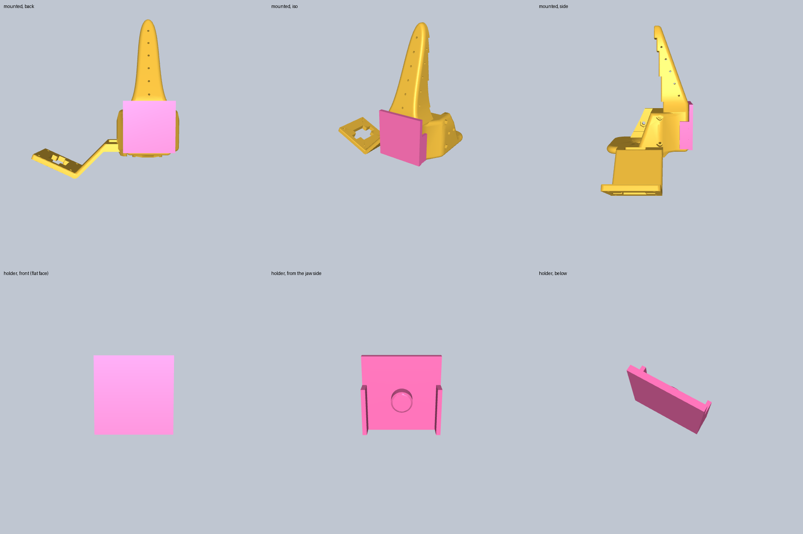
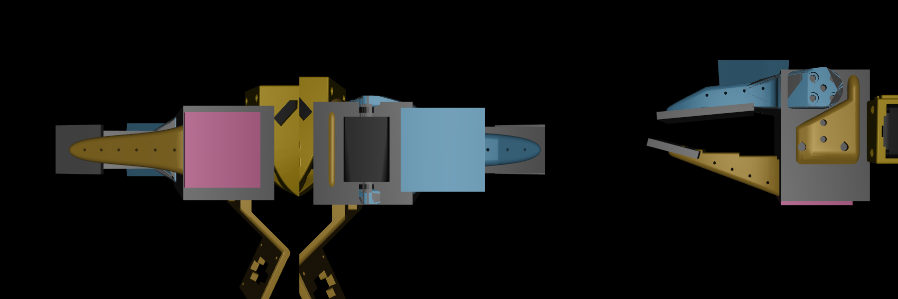

# SO-101 AprilTag parts

3D-printable parts that put AprilTags (family **tag36h11**) on an SO-101 robot arm, so cameras can
find the base and both gripper jaws. All tags are printed in two colours (white + black) on a
Bambu Lab P1S with AMS. Each folder has STL + STEP files, a ready Bambu Studio project (`.3mf`)
and the script that made the part.

| Folder | Part | Tag ids | Status |
|---|---|---|---|
| `foot_tags_id0_id1/` | Cap under the robot foot with two tag holders (left / right) | 0, 1 | printed and used |
| `fixed_jaw_tag2/` | Flat 36 x 36 mm holder that clips on the wrist camera mount (fixed jaw side) | 2 | printed and fitted |
| `moving_jaw_tag3/` | New moving jaw: the official jaw with a 36 x 36 mm tag face built in | 3 | designed, **not printed yet** |
| `d435_tags_id4_id5/` | Two glue-on tags for the RealSense D435 view, 60 x 60 mm with 50 mm black square like the foot tags (tags only, no holder) | 4, 5 | designed, not printed yet |
| `tools/` | Script that builds the Bambu `.3mf` projects, render script (MuJoCo) | | |

Tag ids in use: 0, 1 foot; 2 fixed jaw; 3 moving jaw; 4, 5 D435; 10-13 table; 100-128 calibration boards.

## Printing

**Tags (gripper: 36 x 36 x 1 mm, 30 mm black square; foot and D435: 60 x 60 x 1 mm, 50 mm black):** print **face up**: 1 mm white base on the bed, the
black pattern as the top 0.2 mm. Filament 1 = white, filament 2 = black. (Printed face down, the
small white islands do not stick.) Glue the tag on its holder.

**Tag-2 holder:** flat face on the bed, peg and clips upward. No support needed.

**New moving jaw:** tag face down on the bed. Tree support is enabled for the jaw only (about 2 g),
like the official jaw needs. Unscrew the old jaw from the servo horn and fit this one; check the
gripper open/close calibration afterwards.

**Foot cap:** see `so101_full_underfoot_cap_apriltag_holders.3mf`.

## Geometry

The `*_info.json` files give the tag centre and normal in the part's own mesh frame (mm).

- Moving jaw: same frame as `Moving_Jaw_SO101.stl` from SO-ARM100 and the URDF/MuJoCo mesh
  `moving_jaw_so101_v1.stl`. Tag 3 centre (16, -34, 0) mm, normal +x.
- Tag-2 holder: same frame as the wrist camera mount / `wrist_roll_follower_so101_v1.stl`.
- A tag can be glued in four rotations: write down which way row 0 points when you calibrate.

The tag face on the moving jaw starts about 16 mm from the hinge. Closer is not possible: the
gripper servo and the wrist sweep through that space over the joint range (-10 to 100 deg).
Minimum clearance over the whole range is 3.3 mm (`check_clearance.py`, `free_space.py`).

## Scripts

FreeCAD 1.1 scripts (`FreeCADCmd script.py`) make the solids; the other scripts use Python with
numpy / scipy / mujoco / Pillow. Paths in the scripts point at the original project layout, so
change them before running.

## License

Apache License 2.0, see `LICENSE` and `NOTICE`. The moving jaw is based on
[TheRobotStudio/SO-ARM100](https://github.com/TheRobotStudio/SO-ARM100) (Apache 2.0).
